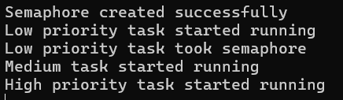
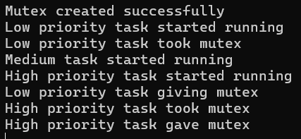

# Activity 0
Semaphore Priority Inversion Effects: 

  - The low priority task takes the semaphore; the high priority task waits on the low priority task to release the semaphore; the medium priority task starves the low priority task and prevents it from releasing the semaphore. The result: unbounded priority inversion.

# Activity 1
Mutex Priority Inversion Effects:

  - The low priority task takes the mutex; the high priority task starts waiting on the mutex, which bumps the low priority task up to a high priority; the medium priority task is no longer able to starve the low priority task, so it's able to release the mutex, and the high priority task can run. The result is that the priority inversion doesn't last indefinitely.